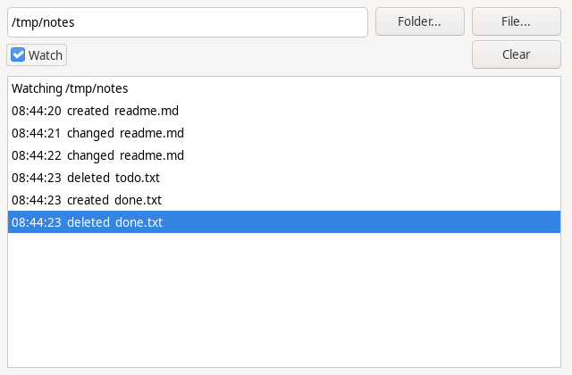

# FileEye

### Know when a file changes, on Linux, Windows and macOS.

Point `TFileEye` at a file or a folder and it tells you when a file there is
created, changed or deleted. Drop it on a form, set `Path`, tick `Enabled`,
and write `OnChange`. No threads to manage, no polling to write, and nothing
to install on the user's machine.



## Use it

On a form: drop **TFileEye** from the **System** tab, set **Path**, set
**Enabled** to True and double-click **OnChange**:

```pascal
procedure TForm1.FileEye1Change(Sender: TObject; const FileName: string;
  Change: TFileEyeChange);
begin
  if Change = fcChanged then
    Memo1.Lines.LoadFromFile(FileName);
end;
```

In code:

```pascal
uses FileEye;

Eye := TFileEye.Create(Self);
Eye.Path := '/home/me/notes.md';
Eye.OnChange := @NotesChanged;
Eye.Enabled := True;
```

| | |
|---|---|
| `Path` | A file or a folder. A folder reports the files directly in it, not those in its subfolders. A file does not have to exist yet, but its folder does. |
| `Enabled` | True watches. Set in the Object Inspector, it starts with the form. Nothing is watched in the designer. |
| `OnChange` | `FileName` (the full path) and `Change`: `fcCreated`, `fcChanged` or `fcDeleted`. On the main thread, once per file per look, however many times the system reported it. |
| `OnError`, `LastError` | Watching could not start, for example because the folder is missing. `Enabled` goes back to False. |

`OnChange` is safe to work in: you can load the file, change `Path`, or turn
the eye off from inside it.

## What counts as a change

Programs save files in different ways, and FileEye reports what happened to
the file, not the way the program saved it:

- **Written in place** (most programs): `fcChanged`.
- **Saved by writing a new file and renaming it over the old one** (gedit,
  Kate, LibreOffice, often vim): also `fcChanged`. The editor's temporary
  file comes and goes between two looks, and you never hear about it.
- **Renamed**: `fcDeleted` for the old name and `fcCreated` for the new one.
- **Deleted**, or the watched folder itself removed: `fcDeleted`.

FileEye looks five times a second and gathers what it saw, so a program
writing a file in a hundred small pieces is one `fcChanged`.

## How it works

The watching is Free Pascal's own `DirWatch` unit from fcl-base, by Michaël
Van Canneyt. It uses what each system offers: inotify on Linux, change
notifications on Windows, and on macOS FSEvents. On Windows and macOS the
system says that a folder changed, and comparing the folder's listing says
what changed.

`DirWatch` is only in Free Pascal's development branch so far, so FileEye
carries a copy in `src/fpc`, under its own name so it cannot clash, with
its fixes marked `FileEye:` in the source:

- On Linux it did not hear files being renamed in or out, so a save by
  rename was missed, and its two rename events were the wrong way around.
- On macOS it watched folders with kqueue, which hears names come and go
  but not a file being written in place. A small FSEvents driver replaces
  it.

The fixes are being offered back to Free Pascal. Once a release has them,
the copy goes and FileEye uses FPC's unit, with nothing changing for you.

## Limits

- Subfolders are not watched.
- On Windows and macOS a change is spotted by the file's size and its time
  to the second. Two writes of the same size within one second look like
  one.
- Network shares report changes only as well as the server tells the
  system, which on some shares is not at all.

## Install

Open `fileeyepkg.lpk` in Lazarus, compile, and use **Install**. The
component shows up on the **System** tab. A program that only uses it from
code can just add the package to its project's required packages.

`demo/FileEyeDemo.lpi` is the program in the picture. `tests/eyetest.lpi`
puts the component through every case above in a temporary folder and
prints what it saw.

## Tested on

Linux Mint (GTK3), Windows 10 and macOS Sequoia 15 on Intel, the last two
in virtual machines: `tests/eyetest` passes all thirteen cases on each. Built
with Free Pascal 3.2.4 and Lazarus 4.8 on the Mac, and with the development
versions on Linux, where Windows is cross-built.

## License

FileEye is [0BSD](LICENSE). The copy of Free Pascal's `DirWatch` in
`src/fpc` keeps Free Pascal's license, the LGPL with a linking exception
([COPYING.FPC](src/fpc/COPYING.FPC)), which lets it go into programs under
any license.
